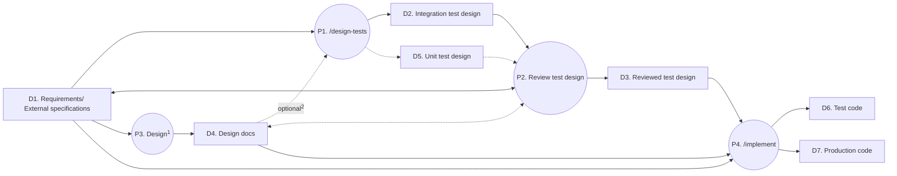

# unity-coding-skills

A [Claude Code](https://claude.ai/code) plugin for Unity development that enables coding agents to work autonomously through a test-first workflow, without constant oversight:

- **Test design** — designing the tests before implementation surfaces gaps and contradictions in the specification, and lets you review the behavior it requires as test cases.
- **Test first** — the agent writes reliable, maintainable tests before production code, then iterates until they all pass: passing tests means done.

> [!IMPORTANT]\
> This plugin relies on Claude Code-specific features, such as the bundled `/simplify` skill and frontmatter fields of skills.
> If you use the skills with a different coding agent, please adapt them accordingly.

## Skills

| Skill                          | Description                                                                             | Required                                                                                                                                                                                      | User-invocable |
|--------------------------------|-----------------------------------------------------------------------------------------|-----------------------------------------------------------------------------------------------------------------------------------------------------------------------------------------------|:--------------:|
| `code-writing-guide`           | Coding conventions and guidelines for Unity C# projects                                 |                                                                                                                                                                                               |                |
| `design-tests`                 | Designs tests from a specification and produces the test design document                |                                                                                                                                                                                               |       ✅       |
| `edit-scene`                   | Creates or modifies scene and prefab files using the `run_method_in_unity` tool         | Rider built-in [MCP Server](https://www.jetbrains.com/help/rider/mcp-server.html) and [Extension for Unity](https://plugins.jetbrains.com/plugin/30357-mcp-server-extension-for-unity) plugin |       ✅       |
| `find-and-setup-analysis-rule` | Finds a code analysis rule for a given coding pattern and sets it up                    |                                                                                                                                                                                               |       ✅       |
| `fix-bug`                      | Reproduces and fixes bugs using a test-first workflow                                   |                                                                                                                                                                                               |       ✅       |
| `implement`                    | Implements a feature test-first, from test design through refactoring                   |                                                                                                                                                                                               |       ✅       |
| `measure-spec-coverage`        | Measures how well the tests cover a specification document                              |                                                                                                                                                                                               |       ✅       |
| `resolve-diagnostics`          | Resolves compiler, Roslyn analyzer, and IDE diagnostics at `warning` or higher severity | Rider built-in [MCP Server](https://www.jetbrains.com/help/rider/mcp-server.html)                                                                                                             |       ✅       |
| `run-tests`                    | Runs Unity tests using the `run_unity_tests` tool                                       | Rider built-in [MCP Server](https://www.jetbrains.com/help/rider/mcp-server.html) and [Extension for Unity](https://plugins.jetbrains.com/plugin/30357-mcp-server-extension-for-unity) plugin |       ✅       |
| `test-designing-guide`         | Test design by modeling specifications with test techniques                             |                                                                                                                                                                                               |                |
| `test-writing-guide`           | Conventions for writing Unity Test Framework test code                                  | [Test Helper](https://github.com/nowsprinting/test-helper) and [UI Test Helper](https://github.com/nowsprinting/test-helper.ui) package                                                       |                |
| `unity-yaml-editing-guide`     | Guidelines for directly hand-editing Unity YAML asset files                             |                                                                                                                                                                                               |                |

> [!IMPORTANT]\
> Some skills require the JetBrains Rider built-in MCP server, IDE plugins, or UPM packages listed in the "Required" column above.
> If you don't use Rider or these packages, please modify the skill accordingly.

> [!TIP]\
> The Rider built-in MCP server also provides tools useful for coding agents, such as `list_directory_tree`, `search_file`, `search_regex`, `search_symbol`, and `search_text`.

## Usage



<sup>1</sup> Use any design skills you prefer, e.g., [grilling](https://github.com/mattpocock/skills), [pstack](https://github.com/cursor/plugins/tree/main/pstack), or [modularity](https://github.com/vladikk/modularity).

<sup>2</sup> Giving `/design-tests` the design docs makes the test design more accurate, but adds test cases for you to review.
Without them, `/implement` designs the test cases for the classes the design docs add on its own, internally.

### Design tests from specifications

```bash
/design-tests [SPECIFICATION]
```

You can state the `SPECIFICATION` in any document—a requirements document, a software design document, or an ADR—given as file paths, issue URLs, or written directly; if omitted, it is read from the conversation.
For a file path, the output goes to a Markdown file with a `-tests` suffix next to it; otherwise, to the conversation.

It designs tests that match the passed specification layer: integration tests (including the UI) from the external specifications, and unit tests from the design docs.

Test cases are designed to verify that the implementation conforms to the specifications(easy to review!), not that they uncover implementation flaws.
They come from modeling the specifications with equivalence partitioning, boundary value analysis, decision table testing, and state transition testing, selected per test target.
To focus on finding defects, ask for the following techniques in your instruction:

- **Combinatorial testing** — tests the combinations of inputs that do not affect the expected result(using only neutral values by default), e.g.,
  ```
  /design-tests @docs/equipment.md, and test the combinations of the character and the weapon with combinatorial testing
  ```
- **Error guessing** — adds test cases from failure patterns common in game development, not from the specification, e.g.,
  ```
  /design-tests @docs/title-screen.md, and add test cases with error guessing
  ```

Modeling the specifications also assesses them: the gaps and contradictions it finds go into the Assessment of each test target, and it asks you when the Assessment fails.

Dependencies:

```text
design-tests
└── test-designing-guide
```

> [!TIP]\
> To leave an item out of the test design, write "TBD" on it in the specification; no test case is designed for it.
> To leave the behavior under a condition open, state it as undefined, e.g., "the result is undefined when HP is negative"; no test case is designed for the condition, and it is listed in the Notes.

### Implement features test-first

```bash
/implement [SPECIFICATION]
```

The `SPECIFICATION` can state requirements, specifications, a software design, and a test design document (e.g., the output of `/design-tests`), for a new feature or a specification change.
It is given as file paths, issue URLs, or written directly; when omitted, it is read from the conversation.
It writes no test code for the test cases marked "unverifiable", "undefined", or "ambiguous", and lists them in the Open questions of its report.

Steps:

1. Splits the test targets into phases, from the ones with no dependencies up, so that tests run against real implemented classes instead of test doubles
2. Runs each phase in a subagent:
   1. Test design of the test cases the test design document lacks, including those of the classes the phase adds
   2. Test First: a compilable skeleton and failing test code (effective, failable tests)
   3. Implementation until all tests pass (Definition of Done)
   4. Safe refactoring to improve internal quality (uses `/simplify` skill and static analysis)

Dependencies:

```text
implement
├── test-designing-guide
├── test-writing-guide
├── code-writing-guide
├── run-tests
├── simplify (built-in skill)
└── resolve-diagnostics
    ├── code-writing-guide
    └── run-tests
```

> [!TIP]\
> To defer an item, write "TBD" on it in the specification; it is neither tested nor implemented.
> It asks you only when the TBD item blocks the implementation.

### Fix bugs through reproduction tests

```bash
/fix-bug [INCIDENT]
```

The `INCIDENT` can specify a bug report or the failed test name, given as file paths, issue URLs, or written directly; when omitted, it is read from the conversation.

Before fixing the bug, it writes a test that reproduces it, runs it to confirm it fails, and shows you the test and its failure message; it starts the fix only after you confirm the reproduction.

Dependencies:

```text
fix-bug
├── test-designing-guide
├── test-writing-guide
├── code-writing-guide
├── run-tests
├── simplify (built-in skill)
└── resolve-diagnostics
    ├── code-writing-guide
    └── run-tests
```

> [!NOTE]\
> Depending on the incident, the root cause may be identified before writing a reproduction test. Under adjustment.

### Resolve diagnostics

```bash
/resolve-diagnostics <PATH>
```

It targets the diagnostics from the compiler, Roslyn analyzers, and IDE inspections at `warning` or higher severity in the files at `PATH`.

Dependencies:

```text
resolve-diagnostics
├── code-writing-guide
└── run-tests
```

### Run tests

```bash
/run-tests [CONDITION]
```

It runs the tests in the Unity Editor or on the player.

### Edit scenes and prefabs

```bash
/edit-scene <INSTRUCTION>
```

It creates or modifies scene and prefab files through a temporary editor script instead of hand-editing YAML.

### Find and set up an analysis rule for a coding pattern

```bash
/find-and-setup-analysis-rule [PATTERN]
```

It searches for a code analysis rule (an IDE inspection or a Roslyn analyzer) that flags the coding pattern and sets it up in the project at `warning` or higher severity.

### Measure specification coverage

```bash
/measure-spec-coverage <PATH>
```

It measures how much of the specification document at `PATH` the test code covers, and lists the elements left unchecked:

1. Models the specification with test techniques (equivalence partitioning, boundary value analysis, decision table testing, and state transition testing) into elements.
2. Checks off each element the test code covers, in two passes:
   1. Reads the test code files whose `// Test-basis:` comments name the specification document, and checks off each element their tests cover.
      `/implement` and `/fix-bug` write these comments at the top of each test code file, listing the specification docs, design docs, and test design docs the tests were written from.
   2. Searches the test classes named after each test target, e.g., `InventoryTest`, and checks off each element still unchecked that their tests cover.
      This finds the tests written without the comments, e.g., before you installed this plugin.

> [!IMPORTANT]\
> It models the specification on every run to count the elements, so the results vary between runs.
> Compare the unchecked elements between runs, not the percentages.

Dependencies:

```text
measure-spec-coverage
└── test-designing-guide
```

## Installation

### User-scope installation

Add the marketplace and install the plugin:

```shell
/plugin marketplace add nowsprinting/unity-coding-skills
/plugin install unity-coding-skills@nowsprinting-unity-coding-skills
```

### Project-scope installation (team sharing)

Add the marketplace and install the plugin with `--scope project`:

```shell
/plugin marketplace add nowsprinting/unity-coding-skills
/plugin install unity-coding-skills@nowsprinting-unity-coding-skills --scope project
```

Commit the resulting `.claude/settings.json` to your repository.

> [!NOTE]\
> When team members trust the project folder, Claude Code prompts them to install the marketplace and plugin automatically.

## Recommended Rider and Unity Project Settings

### 1. MCP server configuration

Some skills require the built-in [MCP Server](https://www.jetbrains.com/help/rider/mcp-server.html) and the extension plugin in JetBrains Rider.
Once configured in Rider, the built-in MCP Server and extension plugin work in other Unity projects without additional setup.

1. Open **Settings > Tools > MCP Server**
2. Turn on **Enable MCP Server**
3. Click the **Auto-Configure** button for the coding agent you use (e.g., Claude Code)
4. Install the [MCP Server Extension for Unity](https://plugins.jetbrains.com/plugin/30357-mcp-server-extension-for-unity) plugin

> [!IMPORTANT]\
> JetBrains Rider 2026.2.1 or later is recommended.

> [!NOTE]\
> The MCP server is registered under different names depending on your Rider version: `rider` on Rider 2026.2 or later, `jetbrains` on versions earlier than 2026.2.

> [!NOTE]\
> When Rider is earlier than 2026.2 and you are using other JetBrains IDEs simultaneously with Rider, port numbers are assigned in the order they are launched.
> For example, if you launch Rider after IDEA, the port number for Rider will be `64343`.

### 2. Install UTF Analyzers (strongly recommended)

[UTF Analyzers](https://github.com/nowsprinting/test-framework.analyzers) diagnose Unity Test Framework API usages that freeze the Unity Editor (e.g., `Assert.ThrowsAsync`, `async` delegates in `Throws` constraints, `DelayedConstraint`) before tests run.
Install either the [UPM package](https://openupm.com/packages/com.nowsprinting.test-framework.analyzers/) via OpenUPM or the [NuGet package](https://www.nuget.org/packages/UTFAnalyzers) via NuGetForUnity.

> [!TIP]\
> If you install the [UPM package](https://openupm.com/packages/com.nowsprinting.test-framework.analyzers/), you do not need to add a reference to the test assembly definition file (asmdef).
> It also installs the following:
> - Unity Test Framework v1.4.6 (dependency)
> - [NUnit.Analyzers](https://www.nuget.org/packages/NUnit.Analyzers) v3.9.0 (bundled)

### 3. Enforcing coding rules via analyzers and inspections

Some skills resolve Roslyn analyzer and IDE inspection diagnostics at `warning` or higher severity during the refactoring phase.
Therefore, any coding rule you want coding agents to respect must be set to `warning` or higher severity in `.editorconfig` or `.globalconfig`.

> [!TIP]\
> To add coding rules not covered by IDE inspections, you can install open-source Roslyn analyzers.
> Unity can load only analyzers built against the Roslyn version it supports, so check
> [Which version of Roslyn analyzers should I use with Unity?](https://github.com/nowsprinting/which-version-of-roslyn-analyzers-should-i-use-with-unity)
> for the version compatible with your project's Unity version.

Code written by coding agents often has maintainability problems, such as leftover unused members and overly complex methods.
The following settings help coding agents avoid these issues.

#### Example: Unused types and members

To prevent leaving unused types and members, add the following to `.editorconfig`:

```
resharper_unused_type_local_highlighting = warning
resharper_unused_type_global_highlighting = warning
resharper_unused_member_global_highlighting = warning
resharper_unused_member_local_highlighting = warning
```

#### Example: Method complexity

To keep method complexity under control, install one of the following Rider plugins:

- [CognitiveComplexity](https://plugins.jetbrains.com/plugin/12024-cognitivecomplexity) plugin
- [CyclomaticComplexity](https://plugins.jetbrains.com/plugin/10395-cyclomaticcomplexity) plugin

> [!WARNING]\
> In Rider 2026.2.1, there is an issue where the `get_file_problems` and `lint_files` tools fail to correctly return diagnostic messages from plugins.
> see: [RIDER-142275](https://youtrack.jetbrains.com/issue/RIDER-142275)

### 4. Untracking temporary files via `.gitignore`

Some skills place temporary editor script files under `Assets/UnityCodingSkills/`. Adding the following pattern to your project's `.gitignore` is recommended:

```gitignore
Assets/UnityCodingSkills*
```

## Contributing

Contributions are welcome. However, we will decline contributions that we cannot maintain — such as adding support for different coding agents or MCP servers. Please fork this repository and customize it for your needs instead.

## License

This project is released into the public domain under the [Unlicense](LICENSE).
