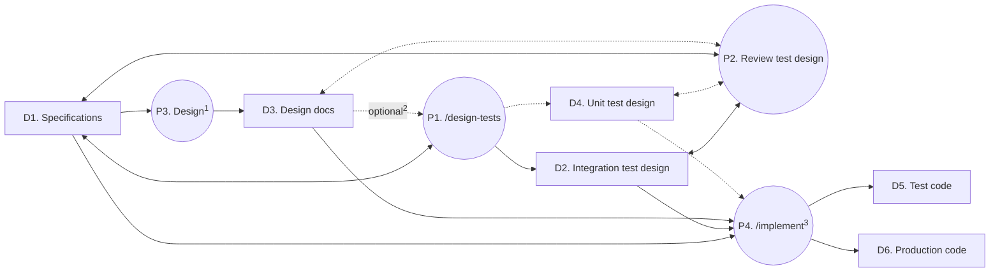

# unity-coding-skills

A [Claude Code](https://claude.ai/code) plugin for Unity development that enables coding agents to work autonomously through a test-first workflow, without constant oversight:

- **Test design** — designing the tests before implementation surfaces gaps and contradictions in the specification, and lets you review the behavior it requires as test cases.
- **Test first** — the agent writes reliable, maintainable tests before production code, then iterates until they all pass: passing tests means done.

> [!NOTE]\
> Some skills rely on Claude Code-specific features, such as the bundled `/simplify` skill and skill frontmatter fields.
> If you use the skills with a different coding agent, please adapt them accordingly.

## Skills

| Skill                          | Description                                                                             | Required                                                                                                                                                                                      | User-invocable |
|--------------------------------|-----------------------------------------------------------------------------------------|-----------------------------------------------------------------------------------------------------------------------------------------------------------------------------------------------|:--------------:|
| `code-writing-guide`           | Coding conventions and guidelines for Unity C# projects                                 |                                                                                                                                                                                               |                |
| `design-tests`                 | Designs tests from a specification and produces the test design document                |                                                                                                                                                                                               |       ✅       |
| `edit-scene`                   | Creates or modifies scene and prefab files using the `run_method_in_unity` tool         | Rider built-in [MCP Server](https://www.jetbrains.com/help/rider/mcp-server.html) and [Extension for Unity](https://plugins.jetbrains.com/plugin/30357-mcp-server-extension-for-unity) plugin |       ✅       |
| `find-and-setup-analysis-rule` | Finds a code analysis rule for a given coding pattern and sets it up                    |                                                                                                                                                                                               |       ✅       |
| `fix-bug`                      | Reproduces and fixes bugs using a test-first workflow                                   |                                                                                                                                                                                               |       ✅       |
| `implement`                    | Implements a feature test-first, from test design through refactoring                   |                                                                                                                                                                                               |       ✅       |
| `measure-spec-coverage`        | Measures how well the tests cover a specification document                              |                                                                                                                                                                                               |       ✅       |
| `resolve-diagnostics`          | Resolves compiler, Roslyn analyzer, and IDE diagnostics at `warning` or higher severity | Rider built-in [MCP Server](https://www.jetbrains.com/help/rider/mcp-server.html)                                                                                                             |       ✅       |
| `run-tests`                    | Runs Unity tests using the `run_unity_tests` tool                                       | Rider built-in [MCP Server](https://www.jetbrains.com/help/rider/mcp-server.html) and [Extension for Unity](https://plugins.jetbrains.com/plugin/30357-mcp-server-extension-for-unity) plugin |       ✅       |
| `test-designing-guide`         | Test design by modeling specifications with test techniques                             |                                                                                                                                                                                               |                |
| `test-writing-guide`           | Conventions for writing Unity Test Framework test code                                  | [Test Helper](https://github.com/nowsprinting/test-helper) and [UI Test Helper](https://github.com/nowsprinting/test-helper.ui) package                                                       |                |
| `unity-yaml-editing-guide`     | Guidelines for directly hand-editing Unity YAML asset files                             |                                                                                                                                                                                               |                |

> [!IMPORTANT]\
> Some skills require the JetBrains Rider built-in MCP server, IDE plugins, or UPM packages listed in the "Required" column above.
> If you don't use Rider or these packages, please adapt them accordingly.

> [!TIP]\
> The Rider built-in MCP server also provides tools useful for coding agents, such as `list_directory_tree`, `search_file`, `search_regex`, `search_symbol`, and `search_text`.

## Usage

Recommended process flow diagram:



<sup>1</sup> Use any design skills you prefer, e.g., [grilling](https://github.com/mattpocock/skills), [pstack](https://github.com/cursor/plugins/tree/main/pstack), or [modularity](https://github.com/vladikk/modularity).

<sup>2</sup> Dashed flows are optional.
Giving `/design-tests` the design docs makes the test design more accurate, but adds test cases for you to review.
Giving them only to `/implement` skips that review: it designs the unit tests internally.

<sup>3</sup> Test-first: it writes the test code, then the production code that passes it.

### Design tests from specifications

```
/design-tests docs/spec/inventory.md, docs/design/inventory/*.md
Write the results to a file named after the specification file with `-tests`
```

It designs high-quality test cases, no more and no fewer than the specification needs, which curbs the coding agent's habit of writing too many tests.

Give it the specification in any document—a requirements document, design docs, or an ADR—as file paths, URLs (e.g., an issue, a wiki page, or a Google Docs document), or written directly; if omitted, it is read from the conversation.
You can tell it where to write the results in your instruction: files or a spreadsheet, e.g., "Write the results to Claude Sheets".

The test cases are derived from the specification, never from the implementation (black-box testing): they verify that the implementation conforms to the specification, so you can review them against it.

The test level follows the subject of each specification: integration tests (including the UI tests) for a scene or prefab, and unit tests for a class or an asset.
Given the external specification and the design docs that state the structure, it excludes from the integration tests the test cases covered by the unit tests.

It models the specifications with the test techniques that fit each test target, and selects the test cases by these test selection criteria by default:

| Test technique           | Unit tests                          | Integration tests                          |
|--------------------------|-------------------------------------|--------------------------------------------|
| Equivalence partitioning | Boundary value coverage             | Equivalence partition coverage             |
| Decision table testing   | Every rule, Boundary value coverage | Every rule, Equivalence partition coverage |
| Combinatorial testing    | All combinations                    | Pairwise                                   |
| State transition testing | 0-switch coverage                   | 0-switch coverage                          |
| Error guessing           | Off by default                      | Off by default                             |

**Options**

```
/design-tests @docs/hud.md, without boundary value analysis
/design-tests @docs/screen-transitions.md, with 1-switch coverage
/design-tests @docs/title-screen.md, and add test cases with error guessing
```

**Assessment**

Modeling the specifications also assesses them: the gaps and contradictions it finds go into the Assessment of each test target, and it asks you when the Assessment fails, then writes the resolutions back into the specification.

Some test cases may be marked as "undefined," "ambiguous," or "unverifiable."
If you are fine with letting the agent decide how to implement them, you can ignore them: no test code is generated from them, since the specification gives them no expected result a test can check.

Dependencies:

```text
design-tests
└── test-designing-guide
```

> [!TIP]\
> To leave an item out of the test design, write "TBD" on it in the specification; no test case is designed for it.
> To leave the behavior under a condition open, state it as undefined, e.g., "the result is undefined when HP is negative"; no test case is designed for the condition.

> [!NOTE]\
> Combinatorial testing here varies, in combination, the inputs an equivalence partitioning or decision table test case gives neutral values to, and checks that its result stays the same, e.g., the other ability scores and equipment slots when damage depends on strength and the weapon.

> [!NOTE]\
> Error guessing is off by default because a guessed failure pattern is worth little as test code that runs continuously.
> Giving the agent the perspectives and having it review the code should suit it better.

### Implement features test-first

```bash
/implement [specification and/or test design, file paths, or URLs]
```

It carries a feature from the specification to refactored code on its own: it writes the tests first, so passing them all defines done, and it asks you only when it finds a problem only you can settle.

The "specification" can state external specifications and design docs, for a new feature or a specification change.
The "test design" is an output of `/design-tests`.
They are given as file paths, URLs (e.g., an issue, a wiki page, or a Google Docs document), or written directly; when omitted, they are read from the conversation.
Given a test design document alone, it implements only what the test cases state.

Steps:

1. Splits the test targets into phases, from the ones with no dependencies up, so that tests run against real implemented classes instead of test doubles
2. Runs each phase in a subagent:
   1. Test design of the test cases the test design document lacks, including those of the classes the phase adds
   2. Test First: a compilable skeleton and failing test code (effective, failable tests)
   3. Implementation until all tests pass (Definition of Done)
   4. Safe refactoring to improve internal quality (uses `/simplify` skill and static analysis)

Dependencies:

```text
implement
├── test-designing-guide
├── test-writing-guide
├── code-writing-guide
├── run-tests
├── simplify (built-in skill)
└── resolve-diagnostics
    ├── code-writing-guide
    └── run-tests
```

> [!TIP]\
> To defer an item, write "TBD" on it in the specification; it is neither tested nor implemented.
> It asks you only when the TBD item blocks the implementation.

> [!NOTE]\
> For traceability, it lists the test bases, the documents the tests were written from, in `// Test-basis:` comments at the top of each test code file.
> [`/measure-spec-coverage`](#measure-specification-coverage) finds the tests by them.

### Fix bugs through reproduction tests

```bash
/fix-bug [incident, failing test name, or issue URLs]
```

It fixes the bug you reported, not a guess at it: before the fix, it writes a test that reproduces the bug, runs it to confirm it fails, and shows you the test and its failure message; it starts the fix only after you confirm the reproduction.

The "incident" can specify a bug report or the failed test name, given as issue URLs or written directly; when omitted, it is read from the conversation.

Dependencies:

```text
fix-bug
├── test-designing-guide
├── test-writing-guide
├── code-writing-guide
├── run-tests
├── simplify (built-in skill)
└── resolve-diagnostics
    ├── code-writing-guide
    └── run-tests
```

> [!NOTE]\
> Depending on the incident, the root cause may be identified before writing a reproduction test. Under adjustment.

## Support skills

### Find and set up an analysis rule for a coding pattern

```bash
/find-and-setup-analysis-rule [pattern or analyzer-name]
```

Identify the code analysis rule (such as an IDE inspection or Roslyn analyzer) that detects the specified coding pattern, and configure it within your project with a severity level of `warning` or higher.

If you specify an analyzer name, it will be installed.

### Measure specification coverage

```bash
/measure-spec-coverage <specification document path or URL>
```

It measures how much of the specification document at the specification document the test code covers, and lists the coverage items left unchecked:

1. Models the specification with test techniques (equivalence partitioning, decision table testing, and state transition testing) into coverage items.
   It leaves out boundary value analysis, which adds conditions the specification does not state.
2. Checks off each coverage item the test code covers, in two passes:
   1. Reads the test code files whose `// Test-basis:` comments name the specification document, and checks off each coverage item their tests cover.
      `/implement` and `/fix-bug` write these comments at the top of each test code file, listing the specification docs and design docs the tests were written from.
   2. Searches the test classes named after each test target, e.g., `InventoryTest`, and checks off each coverage item still unchecked that their tests cover.
      This finds the tests written without comments.

> [!IMPORTANT]\
> It models the specification on every run to count the coverage items, so the results vary between runs.
> Compare the unchecked coverage items between runs, not the percentages.

> [!IMPORTANT]\
> Tests written with version 1 of this plugin, or without this plugin, have no `// Test-basis:` comments.
> It still measures them, finding them by class name alone, but less accurately.

Dependencies:

```text
measure-spec-coverage
└── test-designing-guide
```

### Resolve diagnostics

```bash
/resolve-diagnostics <file paths>
```

It brings the files at the file paths up to the quality bar your analysis rules set: every diagnostic from the compiler, Roslyn analyzers, and IDE inspections at `warning` or higher severity is fixed, or suppressed with its reason reported to you.
It then reformats the files to the solution's code style, and runs the tests to confirm they still pass when it changed the code.

Dependencies:

```text
resolve-diagnostics
├── code-writing-guide
└── run-tests
```

### Edit scenes and prefabs

```bash
/edit-scene <instruction>
```

It creates or modifies scene and prefab files through the Unity Editor API, in a temporary editor script, instead of hand-editing YAML: the file structure stays intact, and uGUI components get the same defaults as when created from the Editor's menu.
It names each GameObject the player operates so that its hierarchy path is unique, and tests can find it.

### Run tests

```bash
/run-tests [filter]
```

It lets the coding agent verify its own work: it runs only the tests under verification in the Unity Editor or on the standalone player.
For visual verification tests, it judges the result by analyzing the screenshots it saves.

To run on the standalone player, say so in the prompt, e.g.,

```bash
/run-tests on the standalone player, with IL2CPP and managed stripping level High
```

> [!NOTE]\
> On macOS, it closes the "Scene(s) Have Been Modified" dialog automatically using `osascript`.
> To run it, you need to grant permission in **System Settings > Privacy & Security > Automation** and **Device Control and Data Access**("Accessibility" when old macOS).\
> If the test run has not started 20 seconds after it is requested, the dialog is closed with "Don't Save"; set the `UNITY_RUN_TESTS_DISCARD_SCENE_CHANGES_DELAY_SECONDS` environment variable to change the delay.
> Detecting whether the dialog blocks a test run depends on the logs the `com.unity.test-framework.performance` package outputs.
> If the package is not installed, the focus shifts to the Unity Editor, even if no dialog appears.

## Installation

> [!IMPORTANT]\
> On native Windows, install [Git for Windows](https://git-scm.com/install/windows).
> The skills' scripts are Bash scripts, and Claude Code runs them with Git Bash.

### User-scope installation

Add the marketplace and install the plugin:

```shell
/plugin marketplace add nowsprinting/unity-coding-skills
/plugin install unity-coding-skills@nowsprinting-unity-coding-skills
```

### Project-scope installation (team sharing)

Add the marketplace and install the plugin with `--scope project`:

```shell
/plugin marketplace add nowsprinting/unity-coding-skills
/plugin install unity-coding-skills@nowsprinting-unity-coding-skills --scope project
```

Commit the resulting `.claude/settings.json` to your repository.

> [!NOTE]\
> When team members trust the project folder, Claude Code prompts them to install the marketplace and plugin automatically.

## Recommended Rider and Unity Project Settings

### 1. MCP server configuration

Some skills require the built-in [MCP Server](https://www.jetbrains.com/help/rider/mcp-server.html) and the extension plugin in JetBrains Rider.
Once configured in Rider, the built-in MCP Server and extension plugin work in other Unity projects without additional setup.

1. Open **Settings > Tools > MCP Server**
2. Turn on **Enable MCP Server**
3. Click the **Auto-Configure** button for the coding agent you use (e.g., Claude Code)
4. Install the [MCP Server Extension for Unity](https://plugins.jetbrains.com/plugin/30357-mcp-server-extension-for-unity) plugin

> [!IMPORTANT]\
> JetBrains Rider 2026.2.1 or later is recommended.

> [!NOTE]\
> The MCP server is registered under different names depending on your Rider version: `rider` on Rider 2026.2 or later, `jetbrains` on versions earlier than 2026.2.

> [!NOTE]\
> When Rider is earlier than 2026.2 and you are using other JetBrains IDEs simultaneously with Rider, port numbers are assigned in the order they are launched.
> For example, if you launch Rider after IDEA, the port number for Rider will be `64343`.

### 2. Untracking temporary files via `.gitignore`

Some skills place temporary editor script files under `Assets/UnityCodingSkills/`. Adding the following pattern to your project's `.gitignore` is recommended:

```gitignore
Assets/UnityCodingSkills*
```

### 3. Install UTF Analyzers (strongly recommended)

[UTF Analyzers](https://github.com/nowsprinting/test-framework.analyzers) diagnose Unity Test Framework API usages that freeze the Unity Editor (e.g., `Assert.ThrowsAsync`, `async` delegates in `Throws` constraints, `DelayedConstraint`) before tests run.
Install either the [UPM package](https://openupm.com/packages/com.nowsprinting.test-framework.analyzers/) via OpenUPM or the [NuGet package](https://www.nuget.org/packages/UTFAnalyzers) via NuGetForUnity.

> [!TIP]\
> If you install the [UPM package](https://openupm.com/packages/com.nowsprinting.test-framework.analyzers/), you do not need to add a reference to the test assembly definition file (asmdef).
> It also installs the following:
> - Unity Test Framework v1.4.6 (dependency)
> - [NUnit.Analyzers](https://www.nuget.org/packages/NUnit.Analyzers) v3.9.0 (bundled)

### 4. Enforcing coding rules via analyzers and inspections

Some skills resolve Roslyn analyzer and IDE inspection diagnostics at `warning` or higher severity during the refactoring phase.
Therefore, any coding rule you want coding agents to respect must be set to `warning` or higher severity in `.editorconfig` or `.globalconfig`.

> [!TIP]\
> To add coding rules not covered by IDE inspections, you can install open-source Roslyn analyzers.
> Unity can load only analyzers built against the Roslyn version it supports, so check
> [Which version of Roslyn analyzers should I use with Unity?](https://github.com/nowsprinting/which-version-of-roslyn-analyzers-should-i-use-with-unity)
> for the version compatible with your project's Unity version.

Code written by coding agents often has maintainability problems, such as leftover unused members and overly complex methods.
The following settings help coding agents avoid these issues.

#### Example: Unused types and members

To prevent leaving unused types and members, add the following to `.editorconfig`:

```
resharper_unused_type_local_highlighting = warning
resharper_unused_type_global_highlighting = warning
resharper_unused_member_global_highlighting = warning
resharper_unused_member_local_highlighting = warning
```

#### Example: Method complexity

To keep method complexity under control, install one of the following Rider plugins:

- [CognitiveComplexity](https://plugins.jetbrains.com/plugin/12024-cognitivecomplexity) plugin
- [CyclomaticComplexity](https://plugins.jetbrains.com/plugin/10395-cyclomaticcomplexity) plugin

> [!WARNING]\
> In Rider 2026.2.1, there is an issue where the `get_file_problems` and `lint_files` tools fail to correctly return diagnostic messages from plugins.
> see: [RIDER-142275](https://youtrack.jetbrains.com/issue/RIDER-142275)

## Contributing

Contributions are welcome. However, we will decline contributions that we cannot maintain — such as adding support for different coding agents or MCP servers. Please fork this repository and customize it for your needs instead.

## License

This project is released into the public domain under the [Unlicense](LICENSE).
